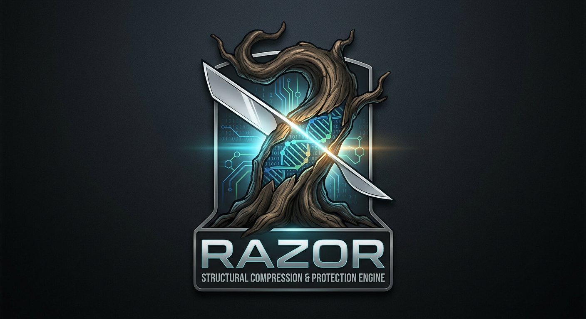

# Razor & RazorZip — Structural compression and protection engine



> **Razor is a structural compression and protection engine designed for archival,
> streaming, adaptive workload compression and protected commercial data operations.**

This public repository is the **evidence and reproduction surface** for Razor. It contains
documentation, verified benchmark methodology and results, corpus manifests, an open-source
benchmark harness, and release/security notes. It does **not** contain the proprietary Razor
codec implementation.

```
OPEN TEST HARNESS (this repo: harness/, docs/, scripts/)
        │
        ▼
COMMERCIAL RAZOR ENGINE (separate, proprietary — invoked as an external binary)
        │
        ▼
OPTIONAL PROTECTION / ARCHIVAL SERVICES (integrity sidecars, SFX, trial licensing)
```

---

## 1. Overview

- **Razor** — structural compression engine with archival and streaming tiers.
- **RazorZip** — archival workflow around the engine (including SFX and optional
  password/online-gated extraction where shipped).
- **This repo** — the open harness that *measures* engines as black-box processes
  (Razor commercial binaries where installed, plus third-party baselines such as
  Brotli, Zstd, XZ, gzip) on standard corpora, with per-file round-trip verification.

Positioning is evidence-based: Razor Max demonstrates particularly strong results across
several structured, binary, document and scientific workloads, while large pure-text
workloads remain an optimisation target (see §4).

## 2. Product positioning

Razor is a **structural compression and protection engine** for:

- archival storage,
- streaming / low-latency paths,
- adaptive workload compression (per-block tournament selects the cheapest framing),
- protected commercial data operations (detached integrity, SFX, trial licensing).

It is **not** positioned as universally superior to every established compressor.
Conclusions in this file are drawn only from the verified CSV evidence shipped in
`docs/benchmarks/`.

## 3. Architecture overview

See [ARCHITECTURE.md](ARCHITECTURE.md). Summary:

- **Harness (open, MIT):** `harness/` — Avalonia (.NET) GUI + CSV schema +
  engine-availability probing + trial-request workflow. The matrix runner and
  corpus downloader exist as library code not yet wired to UI actions
  (see QUICKSTART for the exact current scope). The harness never compiles or
  links proprietary source.
- **Commercial engine (proprietary, not in this repo):** invoked strictly as an
  external process. The harness never compiles or links proprietary source.
- **Protection services (optional, commercial):** detached `.integrity` sidecars,
  SFX containers, password/online-gated extraction, 14-day trial licensing
  (see [docs/security/](docs/security/) and [docs/trial/](docs/trial/)).

## 4. Benchmark methodology

Full method: [BENCHMARKS.md](BENCHMARKS.md) and [docs/benchmarks/METHODOLOGY.md](docs/benchmarks/METHODOLOGY.md).

- Every file is compressed and decompressed; output is compared byte-for-byte.
- Any mismatch is recorded as `RT-FAIL` — failures are never silently dropped and
  never converted into successful rows.
- Timing is wall-clock on the measuring machine; ratios are the stable signal.
- CSV schema is fixed (see §6); each row carries engine, tier, sizes, ratio, timings,
  round-trip status, host/threads/binary/format versions.

## 5. Benchmark results (verified Suite 1)

Source: `docs/benchmarks/suite1-max.csv` (+ per-suite files), traced to the
2026-10-24 licensed Max-tier runs. **62 files, 616,890,856 bytes total
(616.9 MB decimal), zero RT-FAILs across the completed engine/tier matrix.**

Combined archival ratios (lower is better — compressed bytes ÷ original bytes):

| Engine  | Combined ratio |
|---------|---------------:|
| XZ      |         18.70% |
| Zstd    |         19.86% |
| Brotli q11 |      20.26% |
| Razor Max  |      20.70% |

Observed pattern:

- Razor Max is particularly competitive on structured/binary workloads.
- Pure-text workloads such as enwik8 remain an area where XZ/Zstd retain an advantage
  (documented in the per-file tables; enwik8 is the known optimisation target).
- Razor Max achieved outright file-level wins on files including `geo`, `kennedy.xls`,
  `mr`, `ooffice`, and `x-ray` (see `docs/benchmarks/ANALYSIS.md` and the per-suite CSVs).

No other numerical claim in this README exceeds what those CSVs support.
Where a workload is discussed without shipped CSV evidence, it is labelled as such.

## 6. Public harness

`harness/RazorBenchmark/` — open-source, cross-platform (Avalonia UI, .NET 10):

- **Dashboard:** suite/file/engine/tier readouts, progress bar, elapsed/ETA
  placeholders, byte/ratio/round-trip fields, process status; `Export CSV`
  writes the standard schema, `Cancel` cancels. No Run action exists yet.
- **Corpus view:** a single list (Suite 1 Core, Neuro, Genomic, Logs,
  Adversarial, Enwik9 Scale) for suite selection — per-suite tabs,
  Verify/Download buttons, and progress display are not implemented; the
  `DownloaderService` class is library-only.
- **Engine view:** availability report (installed / not-configured /
  unavailable + official docs links); nothing is silently downloaded.
  No enable toggles or path configuration UI exist yet.
- **Corpus downloader (library only):** manifest-pinned source URL,
  version/date, expected size, SHA-256, license/provenance, cache location;
  progress %, retry, failure reporting, hash verification, mismatch rejection
  are implemented in `DownloaderService` but not wired to any control.
- **CSV:** writes the standard schema below; reload is verified headless via
  `--csvcheck` (no in-app Reload control exists yet).

Required CSV schema (`harness` reads/writes exactly this header):

```
suite,corpus,file,engine,tier,original_bytes,compressed_bytes,ratio_percent,
encode_ms,decode_ms,encode_mb_s,decode_mb_s,round_trip,status,timestamp_utc,
host,threads,binary_version,format_version
```

Optional: `trial_id,profile,license_tier,max_threads,probe_skips,notes`.

`status` ∈ `PASS | RT-FAIL | ERROR | TIMEOUT | SKIPPED`.

Build & run: [docs/getting-started/](docs/getting-started/).

## 7. Commercial binaries

**This release ships one verified commercial binary: `razor-train.exe`**
(tuning-profile trainer, windows-x64, build `bundle-20261024-221249`) with its
verified detached `.integrity` sidecar — see `artifacts/hardened/README.md`,
`artifacts/hardened/MANIFEST.txt`, and `approved-binaries.txt` (hashes,
verification status, quarantine record).

**Quarantined (tested, NOT shipped):** `razor-bench.exe`, `razor-watch.exe`
and sfx-decode tooling were removed from the allow-list after independent
functional gates found deterministic round-trip/verify-decode failures on
small inputs in this build (fail-closed flags, no false success; realistic
corpora unaffected — the 62-file Suite-1 evidence still shows zero RT-FAILs).
Details and re-ship criteria: `artifacts/hardened/MANIFEST.txt`.

Each shipped artifact carries: SHA-256, recorded build identifier, verified
detached `.integrity` sidecar, smoke test, and tamper-negative test (modified
binary rejected; missing/corrupt sidecar rejected). The harness otherwise runs
third-party engines and any locally installed Razor binary you point it at —
it never requires a vendored binary.

## 8. Security / protection features

See [SECURITY.md](SECURITY.md) and [docs/security/](docs/security/).

- **Detached integrity:** where shipped, a `.integrity` sidecar lets the launcher
  verify a protected binary before execution. Detached integrity verification detects
  modification of protected binaries and prevents execution when the expected
  integrity record does not match.
- **SFX / password:** where shipped, offline password mode uses AES-256-GCM with an
  Argon2id-derived key; wrong password/corrupt payload fails at the authentication
  tag. Online-gated extraction is policy-controlled token-gated extraction with
  optional online authorization (the implementation validates token structure/claims
  locally and then contacts an authorization endpoint — it is not described as local
  cryptographic JWT signature verification).
- No claim of "tamper-proof" or "independently security audited" is made.

## 9. Trial process

Commercial 14-day trial, documented in [docs/trial/](docs/trial/) (template below).
The licensing service itself remains private; this repo documents only the request
format and the workflow boundary.

```
To: razor@mobisec.cloud
Subject: RazorZip 14-Day Enterprise Trial Request


--- BEGIN TRIAL REQUEST ---
Email Address: user@domain.com
Given Name: [Your First Name]
Last Name: [Your Last Name]
Cell Number: [Your Phone Number]
Business Name: [Company Name or write "PRIVATE"]
Heard About From: [e.g., GitHub, Hacker News, Colleague]
Country: [Your Country]
Town/City: [Your City]
--- END TRIAL REQUEST ---
```

```
USER → structured email → EMAIL PROVIDER → PRIVATE LICENSING SERVICE
(request validation → normalized-email check → one-trial enforcement
 → trial duration → license signing → response email)
```

MCP may orchestrate the private workflow; it is not the email transport itself.

## 10. Limitations

- Codec working-set limit: **512 MiB input boundary** (defensive guardrail). Inputs
  above the supported working limit terminate in a controlled `RA-ENCODE-FAIL`
  (see §11) — they are recorded as failures, never as successes.
- Codec working-set ≠ logical file size. Larger logical files need a tested
  chunking/container implementation; none is claimed until one exists and is tested.
- No unlimited-file-size support is claimed.
- Formalslice/private-local files are referenced for completeness but are not
  redistributed and are not downloadable from here.
- This release contains no commercial engine binary (see §7).

## 11. Known engineering trade-offs

- **Max vs MaxFast:** MaxFast is the speed pick (≈1.6–1.8× Max in measured runs) at a
  small bounded corpus-level deviation. A documented blind spot exists on some noisy
  medical imagery (`mr` +3.0%, `x-ray` +4.1% file-residual in the measured run;
  deterministic, thread-independent). The exception is documented rather than
  re-tuned silently; cutoff re-tuning is future work.
- **Text workloads:** enwik8-scale pure text remains an optimisation target;
  XZ/Zstd retain the advantage there in the verified tables.
- **Speeds** are encode wall-clock on the measuring host and move with load;
  ratios are the comparable signal.
- **ETA** field exists in the Dashboard but no benchmark run can populate it yet
  (no Run path is wired); treat it as a placeholder until the GUI workflow milestone.

## 12. Getting started

1. Install .NET 10 SDK.
2. `dotnet build harness/RazorBenchmark/RazorBenchmark.sln`
3. `dotnet run --project harness/RazorBenchmark/RazorBenchmark -- --selftest`
   (headless checks, no client launched), or without flags for the GUI.
4. In the app: the **Trial** tab (request/copy template) and **Dashboard**
   `Export CSV` are wired. Benchmark Run, corpus Verify/Download, engine
   toggles, and Settings do **not** exist yet — see QUICKSTART for the exact
   current scope.
5. Compare shipped CSVs with `--csvcheck docs/benchmarks/suite1-max.csv`
   (schema + ratio validation) rather than a GUI reload control, which does
   not exist yet.

Details: [docs/getting-started/QUICKSTART.md](docs/getting-started/QUICKSTART.md),
[docs/getting-started/INSTALL.md](docs/getting-started/INSTALL.md).

## 12b. Installation & trial request

- **Supported targets:** Windows x64 (Inno Setup wizard
  `packaging/windows/razorzip-setup.iss` — the only Windows deliverable; the
  WiX/MSI alternative was removed); Linux x64 Debian/RPM
  (`packaging/linux/`). Packages install the **open harness (Core)**; the only
  allow-listed commercial binary is `razor-train.exe` (see `artifacts/hardened/README.md`).
  Architecture support beyond x64 is not claimed. **No installer has been
  compiled or test-installed in this release** (no Inno/WiX/dpkg toolchains on
  the staging host) — the wizard/deb/rpm material is reviewed scaffolding
  with fail-closed gates, not verified installers.
- **GUI install (once built):** run the wizard (default `C:\Program Files\MobiSec\RazorZip`,
  per-user option offered but untested). On the **Request Your 14-Day RazorZip Enterprise
  Trial** page, **Request Trial by Email** opens *your* email app with To,
  Subject, and the full template prefilled (correctly percent-encoded); you
  review and press Send yourself. **Copy Request Template** copies the same
  text as a fallback. The step never blocks installation and never sends
  anything. Silent installs skip this page — use the installed GUI Trial tab
  or CLI afterwards.
- **In-app:** the harness **Trial** tab has the same trial-request buttons
  (no license required to see them; interactive click-through not yet
  test-executed — URI construction is covered by `--selftest`). Opening the
  email client is not proof of sending — the app cannot know whether you
  pressed Send.
- **CLI:** `RazorBenchmark --request-trial` opens the email handler on
  graphical sessions; on headless/SSH systems it prints the recipient, subject,
  and full template with manual instructions (exit 0). If no handler exists it
  prints the manual path and exits non-zero — never a silent success.
  `--copy-trial-template` prints the same text (no GUI popup from services).
- **Linux desktop:** the package ships `razorzip-trial.desktop` (registered
  handler via `xdg-open`, same encoded message) plus the same copy/print
  fallback. No email client is a required dependency.
- **No email is ever sent automatically;** no SMTP credentials, API keys, or
  private endpoints exist anywhere in this flow.
- **If no email app is available:** copy `docs/trial/trial-request-template.txt`
  (installed alongside) into a message to `razor@mobisec.cloud` manually.
- **Returned trial license:** do NOT drop files into assumed directories. The
  issuance email defines placement (authoritative); see
  [docs/security/LICENSE-DIRS.md](docs/security/LICENSE-DIRS.md) for the
  unverified-path policy. Without a license, Core features work and gated
  tiers explain they need a trial/paid license.
- **Integrity:** where commercial artifacts ship (allow-listed only), each
  executable installs with its detached `.integrity` sidecar and the loader
  refuses modified/missing-sidecar binaries. Integrity checks detect
  modification; they are not proof of tamper-proof software or an audit.
- **Build packages:** `powershell ./scripts/build-installers.ps1` (Windows),
  `sh scripts/build-installers.sh` (Linux). Both enforce the allow-list gate,
  fail closed without toolchains, and write `dist/` + a build manifest.
  Without an allow-list you get harness-only scaffolding, clearly marked —
  never fake commercial features.
- **Limitations:** only `razor-train.exe` is allow-listed (bench/watch/decode
  quarantined — see MANIFEST); the installer scripts have never been compiled
  or test-installed here; license-loader paths are unverified (see LICENSE-DIRS.md);
  the `razor-watch` systemd unit is retained disabled-by-default scaffolding for a
  quarantined binary; silent installs exclude interactive email by design.

## 13. Support / contact

- Issues: use this repository's issue tracker
  (`https://github.com/mobiseccloud/Razor-Public/issues`) for harness/docs/benchmark questions.
- Commercial / trial / licensing: `razor@mobisec.cloud` (see [SUPPORT.md](SUPPORT.md)).
- When reporting a benchmark discrepancy, attach your CSV, the manifest, engine
  versions, host/threads, and the exact command or harness settings.

## 14. License information

- Harness (`harness/`), scripts (`scripts/`), workflows (`.github/`): MIT — see [LICENSE](LICENSE).
- Docs in this repo: informational, attribution appreciated.
- Benchmark CSVs (`docs/benchmarks/`): reusable with attribution; underlying corpora
  keep their own licenses (see [CORPUS.md](CORPUS.md)).
- Commercial engine, RazorTrain, profile generation, `razor-licgen`, signing keys,
  production licenses, hardened binaries: proprietary, separate commercial agreement.
  Not included here. A published binary never implies its source may be published.
